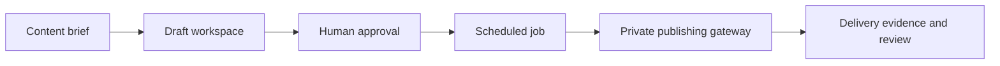

# Conceptual content workflow architecture

This conceptual diagram is not production topology. Original project documentation describes Next.js, TypeScript, PostgreSQL, Prisma, Redis queues and optional AI and social integrations. Live posting and provider connectivity have not been independently verified. Credentials, private prompts, customer records and production implementation are excluded.
